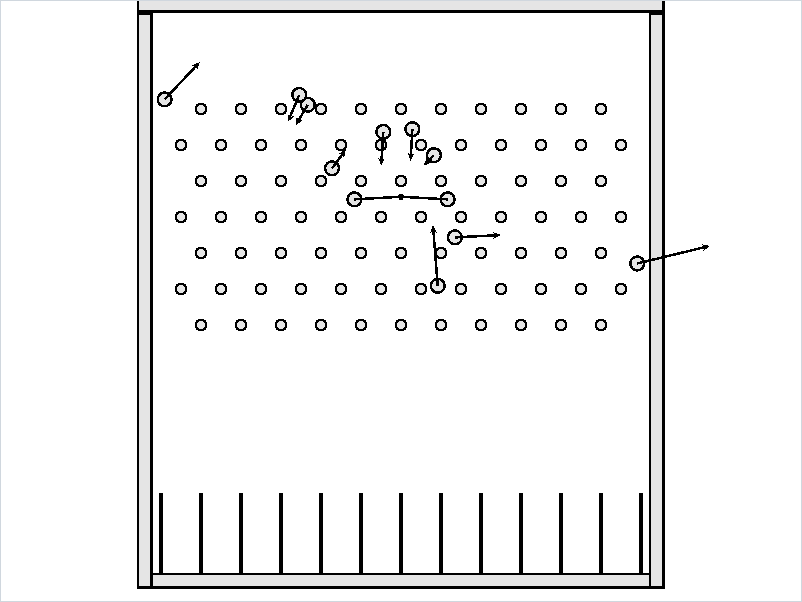
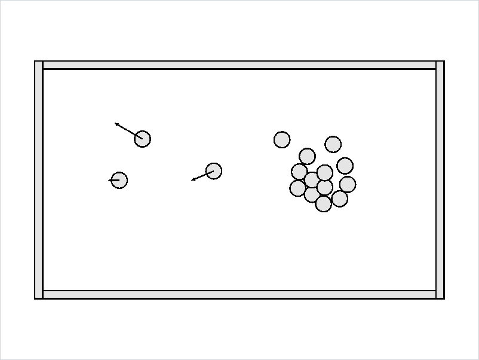
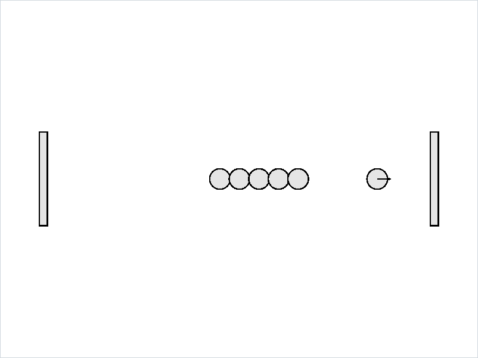
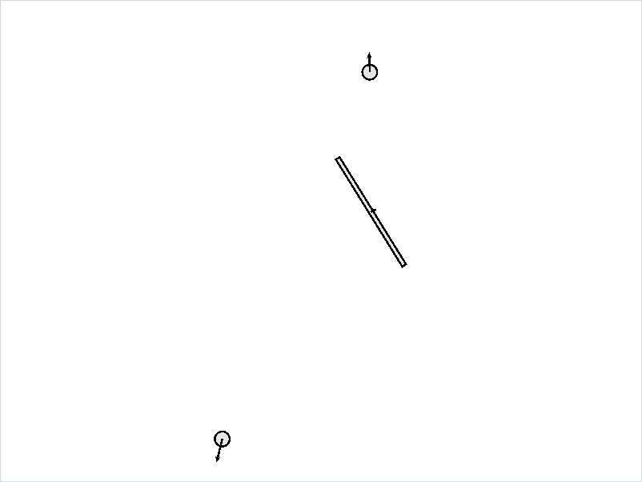

# wuli

A 2D rigid-body physics engine in Rust, using Extended Position Based Dynamics (XPBD).

<p align="center">
  
  
  
  
</p>
<p align="center">
  <sub>Galton Board, Billiards Break, Newton's Row and Spinning Bar, with velocity arrows. See <a href="#scenes">Scenes</a>.</sub>
</p>

## Workspace

| Crate | What it is |
|---|---|
| [`wuli`](wuli) | The engine: bodies, collision detection and the XPBD solver |
| [`wuli-scenes`](wuli-scenes) | Ready-made worlds for the viewer and tests |
| [`wuli-client`](wuli-client) | A macroquad viewer |

## Usage

```bash
cargo run -p wuli-client
```

The toolbar at the top picks the scene, pauses and resets the simulation, resets the camera and sets the simulation speed.

| Input | Action |
|---|---|
| <kbd>Space</kbd> | Pause / resume |
| <kbd>R</kbd> | Reset the scene |
| <kbd>D</kbd> | Show / hide the debug window |
| Left click | Select a body and show it in the inspector |
| Mouse wheel | Zoom |
| Right mouse drag | Pan |

The inspector shows the selected body's shape and mass, and lets you edit its position, velocity, angle and angular velocity.

### Scenes

| Scene | What happens |
|---|---|
| Projectile | A ball thrown horizontally under gravity |
| Colliding Circles | Two balls hit head-on |
| Colliding Rectangles | A rotated bar and a ball hit head-on |
| Newton's Row | A striker hits a row of resting balls, between two walls |
| Billiards Break | A cue ball breaks a rack of 15 balls on a table with cushions |
| Counting π | A ball 100× heavier pushes a light one against a wall: 31 collisions, the first digits of π |
| Spinning Bar | Two balls hit opposite ends of a free bar and set it spinning |
| Galton Board | Balls fall through a grid of pegs into bins |

### As a library

```rust
use glam::{DVec2, dvec2};
use wuli::{RigidBody, World};

let mut world = World::new(-9.81);

// Inverse mass 0 makes a body static
world.add_body(RigidBody::circle(dvec2(0.0, -10.0), DVec2::ZERO, 0.0, 10.0));
let ball = world.add_body(RigidBody::circle(dvec2(0.0, 2.0), DVec2::ZERO, 1.0, 0.5));

world.step(1.0 / 60.0);
println!("{}", world.body(ball).unwrap().position);
```

## Status

| Collision | Supported |
|---|---|
| Circle – circle | Yes |
| Circle – rectangle | Yes |
| Rectangle – rectangle | Not yet: rectangles pass through each other |

All collisions are perfectly elastic, and there is no friction yet.

Run the tests with:

```bash
cargo test --workspace
```

## Resources

- [Extended Position Based Dynamics](https://www.mysimulator.uk/content/articles/xpbd-dynamics.html)
- [dyn4j: SAT (Separating Axis Theorem)](https://dyn4j.org/2010/01/sat/)
- [dyn4j: Contact Points Using Clipping](https://dyn4j.org/2011/11/contact-points-using-clipping/)
- [Erin Catto: Contact Manifolds (GDC 2007)](https://box2d.org/files/ErinCatto_ContactManifolds_GDC2007.pdf)

## License

[GPL-3.0](LICENSE)
